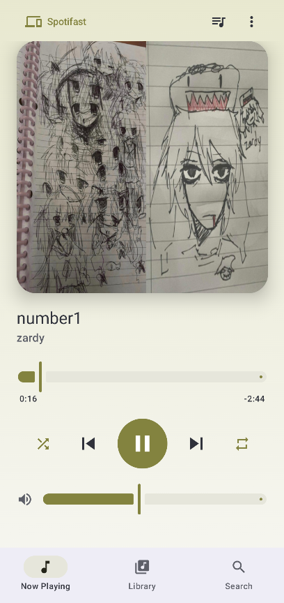
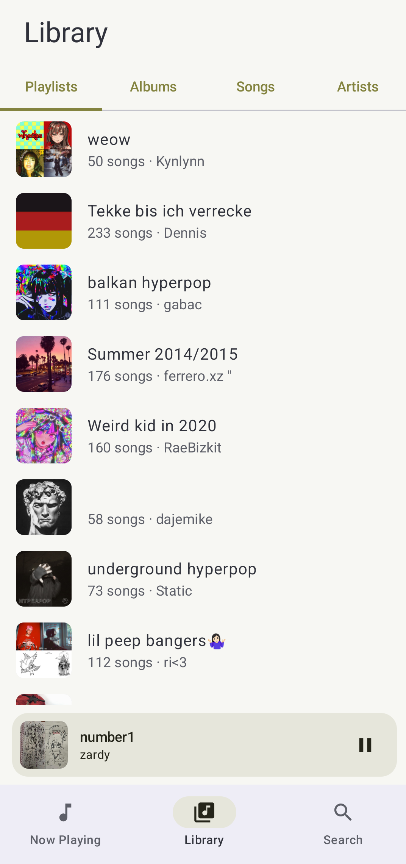
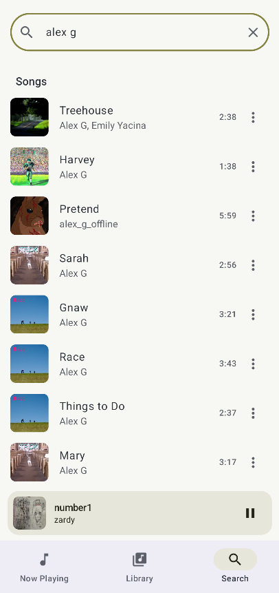

# Serenity

[](https://github.com/serenity-player/serenity/actions/workflows/build.yml)
[](LICENSE)

A calm, Material You remote for Spotify on Android.

Serenity browses your library and controls whatever Spotify device is playing: your phone, computer, speaker or TV.
It uses your wallpaper colors and tints itself with the current album art.

> **Not affiliated with or endorsed by Spotify.** Serenity is an independent open-source project built on the public
> Spotify Web API. Spotify is a trademark of Spotify AB.

## How it works

Serenity doesn't play audio. The Spotify app (or any Spotify Connect device) does the playing, and Serenity is the
remote and the browser. That keeps it small and within Spotify's terms, with one consequence: **Spotify Premium is
required** to control playback.

## Features

- **Now Playing** with play/pause, skip, seek, shuffle, repeat and volume, in colors taken from the album art
- **Connect devices**: see all your devices and move playback between them
- **Library**: playlists, albums, liked songs and followed artists, with paging and pull-to-refresh
- **Search** across songs, artists, albums and playlists, plus artist and album pages
- **Play from here**, a **queue view**, and **add to queue**
- **Media notification, lock-screen controls and a home-screen widget**
- **Adaptive layouts** for tablets and foldables, predictive back, and screen-reader support
- **Private by design**: no accounts, no analytics, no servers of our own

<!--
## Screenshots

| Now Playing | Library | Search |
|---|---|---|
|  |  |  |
-->

## Requirements

- Android 12 or newer
- **Spotify Premium**, for you *and* for the account that owns your developer app (see below)
- The Spotify app, or any Spotify Connect device, to play the music

## Install

1. Download the APK from the [latest release](../../releases/latest). Optionally verify it with `SHA256SUMS.txt`.
2. Open it on your phone and allow installing from your browser or file manager when Android asks.
3. Follow the setup below.

## Setup: bring your own Client ID

Spotify limits how many people can use one developer app, so each person creates their own (free, about five minutes):

1. Create an app in the [Spotify Developer Dashboard](https://developer.spotify.com/dashboard).
2. Add the redirect URI `serenity://callback` and select **Web API**.
3. Make sure your own account is listed under **User Management**.
4. Copy the **Client ID** and paste it into Serenity on first launch.

The full walkthrough, including what each permission is for, is in **[docs/SETUP.md](docs/SETUP.md)**.
If something goes wrong, see **[docs/TROUBLESHOOTING.md](docs/TROUBLESHOOTING.md)**.

### Spotify's limits for developer apps

Since February 2026, apps in Spotify's development mode need a Premium owner, allow one Client ID per developer, and
cap each Client ID at five authorized users. A few endpoints changed too: playlist contents are only readable for
playlists you own (others can still be played), and search returns at most 10 results per type. See
[Spotify's migration guide](https://developer.spotify.com/documentation/web-api/tutorials/february-2026-migration-guide).

## Privacy

- Serenity talks only to Spotify (`accounts.spotify.com`, `api.spotify.com` and Spotify's image servers).
- Your **Client ID** and **tokens** are stored on your device; tokens are encrypted with a key in the Android Keystore.
- There is no analytics, advertising or crash reporting.
- Login uses OAuth with PKCE, so no client secret is involved.
- Remove access at any time at <https://www.spotify.com/account/apps/>.

## Build from source

You need Android Studio (Ladybug or newer) or JDK 17 and the Android SDK.

```bash
git clone https://github.com/serenity-player/serenity.git
cd serenity
./gradlew testDebugUnitTest assembleDebug
```

The debug APK ends up in `app/build/outputs/apk/debug/`.

**Using this as a template?** Before your first commit, run
`scripts/rename-package.sh <package> <github-user> "<copyright holder>"`. It updates the Android namespace and
application ID, Kotlin package declarations and source directories, GitHub repository links, and the MIT copyright
notice. This repository is already configured for `io.github.serenity_player.serenity` and
`github.com/serenity-player/serenity`.

## Project layout

See **[docs/ARCHITECTURE.md](docs/ARCHITECTURE.md)** for how the app is structured and why.

## Contributing

Issues and pull requests are welcome. Start with [CONTRIBUTING.md](CONTRIBUTING.md). Releases are described in
[docs/RELEASING.md](docs/RELEASING.md), and security reports go through [SECURITY.md](SECURITY.md).

## License

[MIT](LICENSE).

Serenity is built with [Jetpack Compose](https://developer.android.com/jetpack/compose),
[Retrofit](https://square.github.io/retrofit/), [OkHttp](https://square.github.io/okhttp/),
[Coil](https://coil-kt.github.io/coil/), [kotlinx.serialization](https://github.com/Kotlin/kotlinx.serialization) and
AndroidX libraries, all under the Apache 2.0 license.
